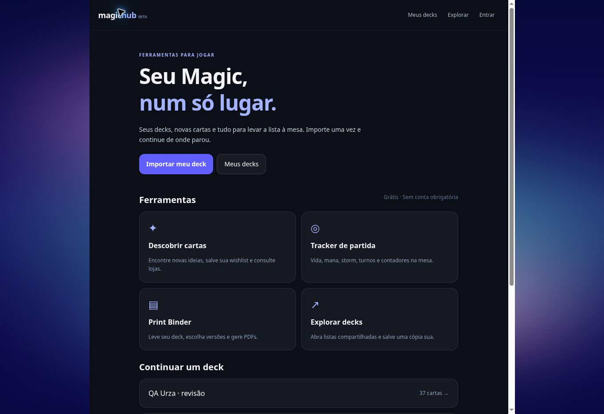

# Magic Hub — product journey audit (2026-11-02)

The merged PR #28 delivered the free-tool landing page, Tracker, Swiper with store links, same-origin Binder, opt-in public snapshots, feedback and contact signup. It did not deliver a deck workspace or ownership lifecycle. Contact signup was not login. Imports were hidden in recommendation filters and flattened quantities. Shared snapshots had no author controls.

## Scope and priority

The unit below is a user-visible gap, not every possible feature. Target: address at least 80% of these 30 relevant gaps. External store availability, recommendation-model quality and paid services are not reclassified as solved by workspace work.

| # | Priority | Gap | Implementation |
|---|---|---|---|
| 1 | P0 | Import a deck from the home page | Direct import CTA and dedicated editor |
| 2 | P0 | Save several named decks | Persistent My decks library |
| 3 | P0 | Preserve card quantities | Quantity model with 1–999 validation |
| 4 | P0 | Preserve commander, mainboard and sideboard | Structured round-trip TXT import/export |
| 5 | P0 | Preserve selected printings | Set/collector identifiers and exact Scryfall resolution |
| 6 | P0 | Edit imported list/name/type/format | Editor with save state and validation |
| 7 | P0 | Revisit a share as its author | Link retained on source deck; edit CTA |
| 8 | P0 | Update share without new URLs | Owner-authorized PUT |
| 9 | P0 | Remove a public deck | Revoke link or trash source deck |
| 10 | P0 | Ownership protection | Hashed random capability; authenticated creator ownership |
| 11 | P1 | Restore accidental deletion | Local tombstone and server soft-delete/restore |
| 12 | P1 | Duplicate a deck independently | New ID without publication credentials |
| 13 | P1 | Copy list reliably | Feedback plus selectable fallback |
| 14 | P1 | Download card list | TXT export with quantities and sections |
| 15 | P1 | Copy/share a URL | Readable URL, clipboard and WhatsApp link |
| 16 | P1 | Save someone else's deck | Independent local copy; original unaffected |
| 17 | P1 | Public vs unlisted choice | Explicit opt-in at publication; reversible |
| 18 | P1 | Search own and public decks | Library and gallery search/empty states |
| 19 | P1 | Private portable backup | Validated JSON export/merge import |
| 20 | P1 | Optional real login | Scrypt passwords, HTTP-only session, logout |
| 21 | P1 | My account and cross-device decks | Private account workspace and debounced sync |
| 22 | P1 | Deck to Swiper and back | Active-deck context, seeded recommendations, save additions |
| 23 | P1 | Swiper lists to saved/shareable lists | Library capture and direct sheet action |
| 24 | P1 | Deck to stores | Reuse the existing multi-store modal from editor/shared view |
| 25 | P1 | Deck to Binder | Pass selected deck/name to same-origin Binder form |
| 26 | P1 | Navigation and errors | Shared header; tracker return; gallery retry; missing-share state |
| 27 | P1 | Excess community promotion | Tool/deck-first home; opt-in news on separate feedback page |
| 28 | P2 | Email verification and password recovery | Deferred; UI states recovery is unavailable; backup remains usable |
| 29 | P2 | Recover author control of legacy snapshots | No safe automatic attribution: PR #28 never stored ownership; organizer moderation needed |
| 30 | P2 | Post-event learning dashboard and analytics | Feedback retained; funnel instrumentation and learning dashboard deferred |

Implemented scope: 27/30 (90%) of the bounded audit. UI verification and any limitations are recorded below; implementation is not evidence that every external service succeeded.

## Data and compatibility

- Existing `mtg-swipe-deck` data is preserved. Saved workspace uses `magic-hub-library`.
- Existing `event-community.json` is migrated on read by adding empty users/sessions collections. Legacy share URLs stay readable.
- New shares store only a hash of the edit capability; the capability is returned once and is kept in the owner's private workspace/backup. Public responses never include it, account IDs or password/session data.
- Unlisted means anyone who receives the URL can view it. Unsaved-to-share decks stay on-device or in the authenticated private workspace.
- Account sync merges by deck ID/timestamp, including deletion tombstones. It does not pretend to resolve simultaneous edits to the same deck.
- Recovery remains possible for trash/backup; no irreversible purge UI is added.
- Single JSON volume matches the existing single-replica deployment. Multi-replica storage and a transactional database remain future work.

## Validation

- Build and ESLint.
- 68 automated tests, including new quantity/section/printing round trips, invalid imports/backups, latest-edit/tombstone merging, share authorization/revocation/restore, account isolation, cookie protection, logout invalidation and legacy opt-in privacy.
- Browser end-to-end validation: recorded in the follow-up validation section after deployment.

## Browser verification — production, 2026-11-02

Observed in the published UI:
- Home → import → save (38 physical cards / 5 entries), including commander and sideboard.
- Scryfall image hydration; exact version identifiers retained. An E2E-discovered name/collector conflict is fixed by resolving exact set/collector identifiers and rejecting mismatched names rather than showing the wrong art.
- Unlisted share creation → public opt-in → gallery search → shared detail.
- Copy list verified against actual clipboard text (including 33 Islands and 2 sideboard cards).
- TXT download observed as a completed browser download.
- Rename/edit → update same share address (no duplicate snapshot).
- Store links opened from saved deck; CardTutor and Mox Vault links and copy action verified. Third-party prices/stock are not asserted as verified by opening these links.
- Deck → Binder auto-fill retained the selected deck name and all 38 physical entries.
- Three-card Binder generated a completed, downloadable A4 PDF (1 page, 551,590 bytes). E2E found the upstream direct-generation form did not strip leading quantities; integration now normalizes pasted text before preparing/generating.
- Duplicate → trash → restore → library search passed. Deleting a shared deck made its old URL unavailable and removed it from gallery search; restoring made it unlisted.
- Account backup JSON downloaded and imported through the file chooser; both 37-card decks remained single copies.

Account password submission is covered by API integration tests; browser validation does not imply a user signed in or supplied credentials. Live multi-device/conflict UX, mobile gesture ergonomics and third-party store inventory remain outside these completed UI checks.

## Recommendation investigation and final integration

Production runtime logs confirmed that the old website endpoint returned HTML and 403 from Railway. The old scraper also no longer matched the page. Those failures sent the feed to global EDHREC popularity; they are integration failures, not evidence that the public recommendation model is bad.

The current [official API documentation](https://recommander.cards/api/) specifies `https://api.recommander.cards/public-release/api/decks/recommend/top`, a `result_code`/`data` envelope and up to 200 suggestions. A direct request for Urza returned 85 ranked results rather than the website route's 25. The public score has no fixed range and is only comparable within one response.

Final implementation uses this official endpoint, unwraps its envelope, preserves raw scores when no legacy metadata exists, deduplicates concurrent identical requests, caches identical deck queries, debounces new selections and honors upstream rate-limit errors. The live page scraper is removed. The UI labels a model feed separately from general-popularity fallback; no card-type/color grouping or arbitrary random shuffle is introduced. The configurable pile table is recorded in `swiper-table-backlog.md`.

The official live Meren evaluation returned 86 cold-start candidates and 147 with ten sacrifice/reanimator seed cards. It found 13 diagnostic synergy matches in the top 25, with no selected-card leaks. These are diagnostic observations, not a universal quality score. Tracker life/mana/storm increment/decrement, settings navigation and return to Hub also passed in the browser.

